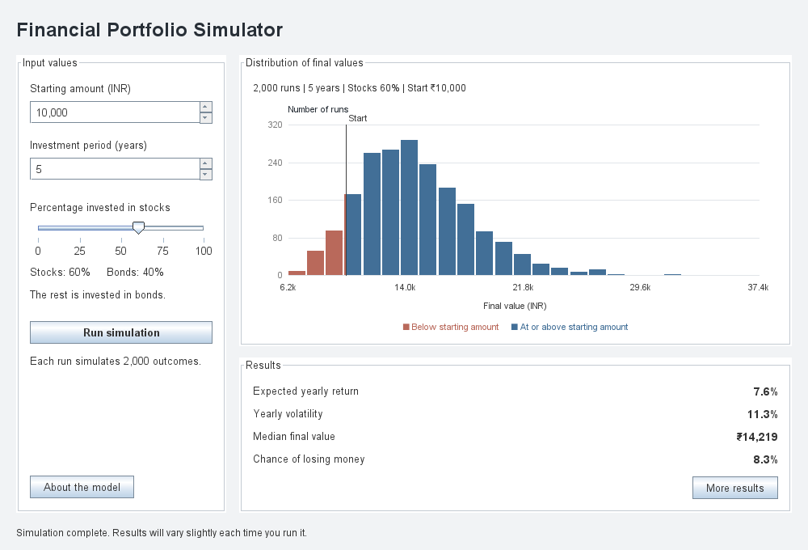

# Financial Portfolio Simulator & Risk Calculator

A Java-based financial risk engine and interactive Swing application that models portfolio performance using standard **ISC Statistics** (Mean, Standard Deviation, Variance) and **Monte Carlo Simulations**.

---

## Project Overview
Investors often struggle to quantify portfolio risk due to market uncertainty. This application allows users to simulate the performance of a multi-asset portfolio (e.g., Stocks vs. Bonds) over a 5-year period. 

Using **Geometric Brownian Motion**, the engine executes 2,000 randomized market iterations to generate continuous returns and output statistical probability distributions.

---

## Features
* **Interactive Swing GUI:** Real-time stock/bond allocation slider controls.
* **Custom Java2D Histogram:** Visualizes final portfolio distributions, color-coding gains (green) and net losses (red).
* **Statistical Risk Metrics:**
  * **Expected Annual Return ($E[R_p]$)** & **Portfolio Volatility ($\sigma_p$)**
  * **Sharpe Ratio:** Evaluates risk-adjusted returns relative to a risk-free rate.
  * **95% Value at Risk (VaR):** Predicts worst-case loss scenarios at a 95% confidence interval.
  * **5-Year Loss Probability:** Quantifies the exact percentage chance of ending below starting capital.
### 📊 Simulation Output Examples

| Default Allocation | Stocks Portfolio Output |
|:---:|:---:|
| 
|  |

### Current dashboard




---

## Mathematical Foundations

### 1. Portfolio Expected Return & Variance
$$\text{Expected Return: } E[R_p] = \sum (w_i \cdot \mu_i)$$

$$\text{Portfolio Variance: } \sigma_p^2 = w_A^2 \sigma_A^2 + w_B^2 \sigma_B^2 + 2 w_A w_B \text{Cov}(A,B)$$

### 2. Monte Carlo Asset Paths (Geometric Brownian Motion)
To model compounding continuous returns without negative asset values:
$$S_t = S_0 \cdot \exp\left(\left(\mu - \frac{1}{2}\sigma^2\right)t + \sigma \sqrt{t} Z\right)$$
*Where $Z \sim N(0,1)$ is a standard normal random variable.*

---

##  Project Structure
```text
FinancialPortfolioSimulator/
└── src/
    └── portfolio/
        ├── Asset.java                 # Asset data model (Return, Volatility)
        ├── Portfolio.java             # Multi-asset statistical calculator
        ├── MonteCarloSimulator.java   # Simulation engine using Gaussian draws
        └── PortfolioGUI.java          # Swing interface & Java2D histogram painter
